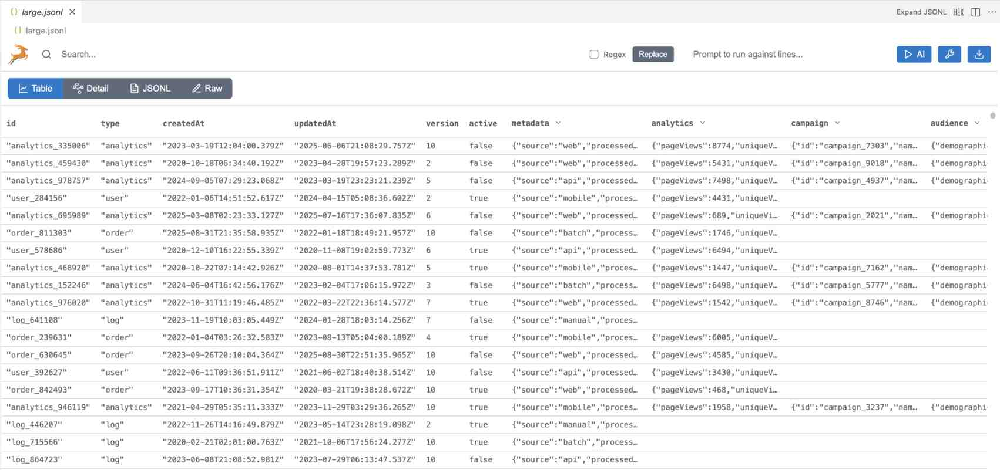
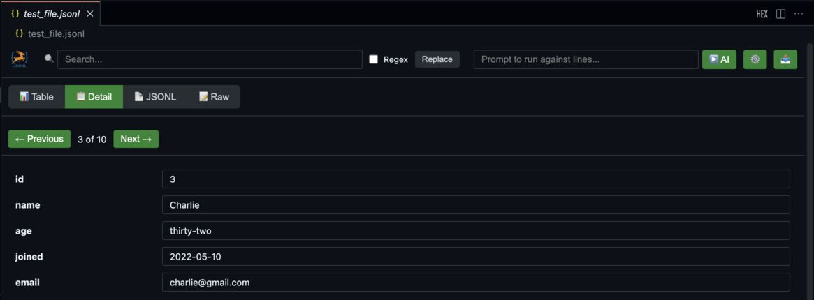
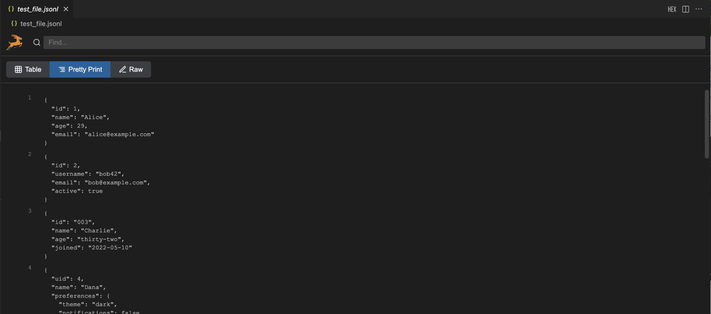
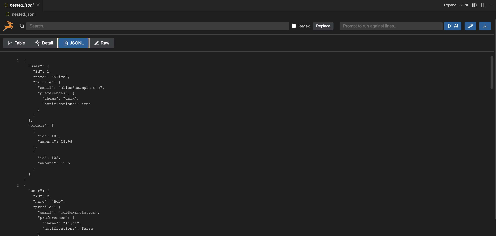

# JSONL Gazelle

<div align="center">
  
</div>

Fast JSONL viewer / editor for VS Code with advanced features including Table View and Pretty Print view. JSONL (JSON Lines, also known as NDJSON — newline-delimited JSON) is increasingly important for machine learning datasets, log analysis, data streaming, and LLM training. Unlike regular JSON, it can be processed line-by-line making it perfect for large datasets. Also works for NDJSON.










## What's new

- *v0.7.4*: Bug fixes, several of which could lose data — updating is recommended:
  - Moving, sorting or duplicating rows no longer turns large integer IDs that differ only in their last digits (Twitter / Discord-style IDs) into copies of one another
  - Adding a column, by hand or with AI, under the name of a field the table doesn't show (because only a few rows have it) or of a nested field such as `user.name` is now refused instead of wiping that field's values
  - A cell edit is written to the file at once, so saving or closing the tab right after `Enter` keeps it
  - AI columns and rows: edits made while the model is working are turned away with a warning instead of being lost or shifting values onto the wrong rows, and a change to the file from outside is kept. One failed request leaves one empty cell rather than discarding the whole column. Prompts no longer see the "generating" placeholder or garble `$` in your data; `{{row.field}}` takes any field name (`first-name`, `Full Name`, `@timestamp`) and shows objects as JSON. Answers like ZIP codes, phone numbers and long IDs stay text, and generated rows keep every field of the rows around them
  - Sorting: timestamps without a time zone sort the same in every time zone; long numeric IDs stored as text sort exactly; `1.500 €` sorts as fifteen hundred in columns that use a decimal comma; `3.8` sorts before `3.10`; numbers mixed with text like `n/a` sort as numbers; and a column you have filled with numbers sorts numerically
  - Columns: collapsing a column also collapses the columns expanded inside it; columns of empty arrays or objects no longer vanish when expanded; expanding during a search makes columns for every row's fields; and an expanded column no longer comes back hidden when the file is reopened
  - Split Large File asks before replacing the parts of an earlier split (so old parts are never left beside new ones), keeps the file's bytes exactly, including text that isn't UTF-8, and removes its parts if the split fails
  - Diff: big changes to large files line up row by row instead of showing nearly everything as modified, a deleted row next to an edited one is paired correctly, changed large IDs show their real digits, and line-ending-only differences say so. Diff with Git HEAD works with Git in other languages, on files deleted from disk and on symlinked files, and says when Git isn't installed
- *v0.7.3*: Bug fixes, several of which could lose data — updating is recommended:
  - Table and Pretty Print edits now change only the rows you edit. Lines that aren't valid JSON, blank lines, large integer IDs, number spellings like `1.50`, CRLF line endings and the final newline are all kept; before, a single cell edit rewrote the whole file and dropped them
  - With several JSONL files open, editing one could change another, or even replace it with the other file's rows. Each editor now works on its own file
  - Large files: an edit made while the file is still loading, or in Pretty Print opened before loading finished, no longer cuts the file short, and a reload during loading no longer mixes in old rows. A half-typed edit in Pretty Print no longer freezes VS Code on a big file
  - Keys containing dots (`"user.name"`, common in log records) show, sort, edit and export correctly
  - Find/Replace searches every row, not just the rows scrolled into view; replaces into the right row after the view re-sorts; and keeps text as text (no stray quotes)
  - Version numbers and IP addresses sort naturally; dragging a column header moves the right column when some columns are hidden; one invalid line no longer sends Table view back to Raw after every change
  - Split Large File no longer duplicates lines when the disk is slow; Diff with Git HEAD works for files reached through a symlinked folder and for Git LFS files, and lines up large files exactly; CSV export includes keys that appear in only a few rows
- *v0.7.2*: Optional format-on-save, off by default — add spaces for readability (`{"id":123}` → `{ "id": 123 }`) and turn single quotes into double quotes so objects pasted from JavaScript become valid JSON. See [Settings](#settings)
- *v0.7.1*: Pretty Print line numbers stay on the right records after edits — deleting or pasting a collapsed object no longer leaves the numbers (and `Ctrl`/`Cmd+Alt+↑/↓` entry jumps) pointing at the wrong lines
- *v0.7.0*: The cell cursor now reaches the headers — arrow up into a column header and press `S` to cycle its sort, arrow left into a row number and press `U` / `D` to move that row or `Delete` to remove it. A hint names the keys as you arrive, then fades
- *v0.6.3*: Spreadsheet keyboard navigation in Table View — arrow keys move a cell cursor, `Enter` edits it, `Tab` advances to the next cell
- *v0.6.2*: Sort by column, with timestamps and currency amounts detected automatically; hidden columns are now counted on the row-number header and unhidden with one click
- *v0.6.1*: Updated dependencies
- *v0.6.0*: File stats popover (record count, column count, file size); "Unhide Column" context menu to restore hidden columns; improved toolbar layout and stability
- *v0.5.2*: Faster loading for large files
- *v0.5.1*: Reduced package size
- *v0.5.0*: Diff view; export to CSV; AI add now supports for Anthropic, Gemini, Ollama; persistent settings; various fixes
- *v0.4.3*: Line-by-line navigation in Raw and Pretty print mode, fixed small bugs, updated models.
- *v0.4.2*: Fixed AI settings persistence so model/system prompt changes are saved even when the API key remains unchanged.
- *v0.4.1*: Improved editing reliability with row/insertion ordering fixes, safer autosave behavior, and less intrusive rating prompts.
- *v0.4.0*: Added AI-powered column suggestions from the context menu, manual column insertion improvements, and row filtering mapping tests.
- *v0.3.4*: Improved AI settings flow when API keys are missing, plus dialog polish and stability fixes.
- *v0.3.1*: Added a **Split into Parts (100MB+)** command in the file context menu for very large JSONL files.
- *v0.3.0*: Added a substantially improved Pretty Print view with syntax highlighting.
- *UX updates*: Added support for light themes and documented keyboard shortcuts for Pretty Print entry navigation (`Ctrl+Alt+↑/↓`, or `Cmd+Option+↑/↓` on macOS) plus line move shortcuts (`Alt+↑/↓`, or `Option+↑/↓` on macOS).

## Features

- **Fast Table View**: Automatically detects common JSON paths and displays them as table columns
- **Smart Column Detection**: Maps common subpaths of each JSONL row into table columns automatically
- **Column Expansion**: Click ▼ to expand objects/arrays into separate columns (e.g., `user.name`, `orders[0]`)
- **Column Management**: Right-click context menu on table headers to add, remove, or toggle column visibility. Hidden columns are counted by a badge on the row-number header — click it to bring them back
- **Spreadsheet Keyboard Navigation**: Click any cell in Table View to place a cell cursor, then drive the table from the keyboard — arrow keys move a cell at a time, `Enter` edits the cell under the cursor, `Tab` advances to the next one
- **Keyboard Header Actions**: Arrow off the top of the grid onto a column header and `S` cycles that column's sort; arrow off the left onto a row number and `U` / `D` move that row up and down the file while `Delete` removes it. A hint appears with the cursor to name the keys, and fades once you have read it
- **Sorting**: Right-click a column header and open the **Sort** submenu — **Display Sorted** reorders just the view and leaves the file alone, **Sort Rows** reorders the file itself (undo with `Ctrl`/`Cmd+Z`). Values are typed automatically, so timestamps sort chronologically and amounts like `$1,200.00` sort by value rather than as text
- **JSONL-Aware Diff**: Diff a file against Git HEAD or another JSONL file with row alignment and field-level change highlighting — edited rows show exactly which fields changed (`old → new`) instead of a wall of raw JSON
- **Memory Efficient**: All processing happens in-memory without creating separate files
- **AI Features**: Generate columns and rows with AI using OpenAI, Anthropic, Google Gemini, or a local OpenAI-compatible server (Ollama, LM Studio, vLLM, ...) — model lists are fetched live from each provider

## Usage

1. Open any `.jsonl` or `.ndjson` file in VS Code
2. The file will automatically open in the JSONL Gazelle viewer
3. Table View: Click ▼ buttons in column headers or double-click expandable cells to expand objects/arrays into separate columns
4. Table View keyboard navigation: Click a cell (or press an arrow key) to place the cell cursor, then use `↑` `↓` `←` `→` to move a cell at a time, `Home` / `End` for the first/last column, `Page Up` / `Page Down` for a screenful of rows, `Enter` (or `F2`) to edit the cell, `Tab` / `Shift+Tab` to move to the next/previous cell, and `Esc` to put the cursor away. While editing, `Enter` saves and steps down a row, `Tab` saves and steps to the next cell, and `Esc` discards the edit
5. Table View header actions: keep pressing `↑` past the first row to put the cursor on a column header, where `S` cycles that column's display sort (ascending → descending → off). Press `←` past the first column to put it on a row number, where `U` and `D` move that row up and down the file and `Delete` removes it (moving is unavailable while the view is display-sorted, since screen order and file order no longer match). Both headers show a hint naming their keys, which fades after a few seconds
6. Pretty Print view: You can edit inline. The gutter numbers each record on its first line, and the numbers follow your edits, including folding, deleting or pasting collapsed objects
7. Pretty Print navigation: Use `Ctrl+Alt+↑` / `Ctrl+Alt+↓` (`Cmd+Option+↑` / `Cmd+Option+↓` on macOS) to jump between JSONL entries
8. Raw view navigation: Use `Ctrl+Alt+↑` / `Ctrl+Alt+↓` (`Cmd+Option+↑` / `Cmd+Option+↓` on macOS) to jump to the previous/next JSONL line
9. Move current line: Use `Alt+↑` / `Alt+↓` (`Option+↑` / `Option+↓` on macOS) to move the current line up or down in the editor
10. Diff view: Run **JSONL Gazelle: Diff with Git HEAD** (command palette, editor title button, or right-click in the Explorer / Source Control view) to see uncommitted changes with per-field highlighting; use **JSONL Gazelle: Compare with JSONL File...** to compare two files. Click a modified row to see the full before/after JSON, and click a `⋯ unchanged lines` separator to reveal hidden context

## Settings

Open VS Code's Settings (`Ctrl`/`Cmd+,`) and search for **JSONL Gazelle**. Settings apply to all files and persist across sessions.

### Format on save

Both options are off by default, which saves the file exactly as written. When turned on, they run every time a `.jsonl` or `.ndjson` file is saved (except delayed auto-save, so text isn't rewritten while you type). Lines that aren't valid JSON are always left alone.

| Setting | Default | What it does |
|---|---|---|
| `jsonl-gazelle.formatOnSave.spaceOut` | off | Adds spaces inside objects and after colons and commas for plain-text readability: `{"id":123,"tags":["a","b"]}` becomes `{ "id": 123, "tags": ["a", "b"] }`. Text inside strings and the exact spelling of numbers are kept as is |
| `jsonl-gazelle.formatOnSave.convertSingleQuotes` | off | Turns single-quoted strings into double-quoted ones, so objects copied from JavaScript become valid JSON: `{'id': 'a'}` becomes `{"id": "a"}`. Only applies to lines that are invalid JSON and become valid after the conversion; apostrophes inside double-quoted strings (`"it's"`) are untouched |

### Large files and performance

| Setting | Default | What it does |
|---|---|---|
| `jsonl-gazelle.largeFile.splitThresholdMB` | 100 | File size in MB above which JSONL Gazelle offers to split the file into parts |
| `jsonl-gazelle.largeFile.partSizeMB` | 50 | Maximum size in MB of each part when splitting |
| `jsonl-gazelle.performance.chunkedLoadingThreshold` | 1000 | Files with more lines than this load progressively in the background |
| `jsonl-gazelle.performance.maxMemoryRows` | 50000 | Above this many rows the file is treated as very large: the loading banner says so, and **Sort Rows** (which rewrites the file) is turned off in favor of **Display Sorted** |

AI provider, API keys and model are set in the in-app settings dialog (gear icon in the toolbar) rather than in VS Code's Settings.

## Extension Development

1. Clone this repository
2. Run `npm install` to install dependencies
3. Run `npm run compile` to build the extension
4. Press F5 to run the extension in a new Extension Development Host window

## Test Data Generation

For testing with large datasets, you can generate a comprehensive test file with 45,000 lines (~64MB) containing varied fields and nested structures:

```bash
# Generate large test data file
cd test-data
node generate-large.js
```

This will create `test-data/large.jsonl` with:
- **User profiles** with nested addresses, preferences, and social media links
- **Orders** with items, pricing, shipping, and tracking information  
- **Analytics data** with metrics, device info, and campaign details
- **Log entries** with request details, performance metrics, and error information
- **Mixed data types**: strings, numbers, booleans, arrays, objects
- **Nested structures** up to 4-5 levels deep

The generated file is automatically excluded from git via `.gitignore` to keep the repository lightweight.

## What's next / Roadmap
- [ ] **LLM / chat-format awareness**: detect `messages: [{role, content}]` rows and render them as a conversation, with format validation for fine-tuning and eval files
- [ ] **Row detail side panel**: a resizable panel showing the selected row as pretty-printed JSON, so large fields stay readable without widening the table https://github.com/gaborcselle/jsonl-gazelle/issues/38
- [ ] **Column profiling / stats popover**: per-column type distribution, null rate, distinct count, min/max/mean, and top values from the header context menu

## License

MIT License. See [LICENSE](LICENSE) file for details.
